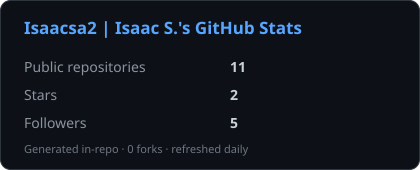
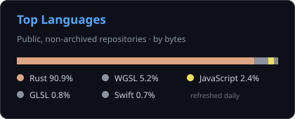
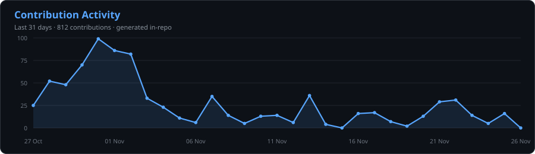

<p align="center">
  
</p>

<h1 align="center">Isaacsa2 | Isaac S.</h1>

<div align="center">

[](https://github.com/denvercoder1/readme-typing-svg)

<br>

[](https://github.com/isaacsa2)
[](https://isaacsa2.online)
[](https://buymeacoffee.com/isaacsa2)


</div>

---

## `whoami`

🇧🇷 **PT-BR**

Sou **Isaac S.**, conhecido online como **Isaacsa2** — estudante de **Sistemas de Informação** que gosta de programar, testar ideias e cutucar software até entender como ele funciona.

Curto IA, simulação, sistemas, web, robótica e open source. Se alguma coisa quebra de um jeito estranho, existe uma chance preocupantemente alta de eu acabar lendo renderer, driver, log ou código às 3 da manhã só pra descobrir **por quê**.

🇺🇸 **EN**

I'm **Isaac S.**, also known online as **Isaacsa2** — an **Information Systems** student who likes coding, testing ideas and poking at software until I understand how it works.

I'm into AI, simulation, systems, web, robotics and open source. If something breaks in a particularly weird way, there's a suspiciously high chance I'll end up reading renderer code, drivers or logs at 3 AM just to find out **why**.

```text
Isaacsa2 | Isaac S.
├─ code
├─ simulation
├─ artificial intelligence
├─ open source
├─ web
├─ robotics
└─ "why did this work yesterday?"
```

---

## 🚌 openOMSI

<div align="center">

### Modern engine. Old simulator. Plenty of weird bugs to chase.

</div>

🇧🇷 Tenho contribuído e testado bastante o **openOMSI**, uma recriação open source do motor do OMSI 2. Normalmente acabo no meio de controles, volantes, Force Feedback, multiplayer, renderer, performance, Android, compatibilidade e bugs específicos demais pra parecer coincidência.

🇺🇸 I've been actively contributing to and testing **openOMSI**, an open-source recreation of the OMSI 2 engine. I usually end up somewhere around controls, steering wheels, Force Feedback, multiplayer, rendering, performance, Android, compatibility and bugs that are way too specific to feel normal.

<div align="center">

[](https://github.com/openOMSI-org/openOMSI)

`Controls` · `FFB` · `Multiplayer` · `Rendering` · `Performance` · `Android` · `Compatibility`

</div>

---

## 🌐 NCT Transportes

🇧🇷 Idealizei o **NCT Transportes**, um projeto do Grupo NCT para registrar e preservar fotografias e informações sobre transportes virtuais do Roblox, OMSI 2 e Proton Bus Simulator.

🇺🇸 I created **NCT Transportes**, a Grupo NCT project documenting and preserving photos and information about virtual transport in Roblox, OMSI 2 and Proton Bus Simulator.

<div align="center">

[](https://isaacsa2.online)

</div>

---

## ⚙️ AC6C Tune Maker

🇧🇷 Uma ferramenta web que criei para facilitar a criação e o ajuste de **Tunes AC6C / A-Chassis para Roblox** — motor, torque, câmbio, diferencial, suspensão, freios, direção, elétrica e exportação em Luau.

🇺🇸 A web tool I built to make **AC6C / A-Chassis tuning for Roblox** less painful — engine, torque, gearbox, differential, suspension, brakes, steering, electric systems and Luau export.

<div align="center">

[](https://ac6.isaacsa2.online/)
[](https://github.com/isaacsa2/AC6)

</div>

---

## 💼 Portfolio / Projetos em destaque

🇧🇷 Além de experimentar tecnologias, gosto de entregar algo que funcione e de mostrar **o problema, a implementação e o resultado**. Abaixo estão projetos próprios e contribuições open source que podem ser avaliados pelo código.

🇺🇸 Beyond exploring technologies, I aim to ship working software and show **the problem, the implementation and the result**. These are personal projects and verifiable open-source contributions.

| Projeto / Project | O que demonstra / What it demonstrates | Código e demonstração / Source & demo |
| --- | --- | --- |
| **AC6C Tune Maker** | Ferramenta web para configurações de veículos com cálculos e exportação Luau. / Vehicle tuning web tool with calculations and Luau export. | [Código](https://github.com/isaacsa2/AC6) · [Demo](https://ac6.isaacsa2.online/) |
| **ERP by Isaac** | ERP didático com Python/Flask, SQLite, estoque, PDV e laboratório SQL. / Educational ERP and SQL lab. | [Código](https://github.com/isaacsa2/erpbyisaacsa2) · [Demo educacional](https://erpbyisaacsa2.onrender.com/) |
| **openOMSI** | Colaboração em motor de simulação, renderização, multiplayer, interface e estabilidade. / Work on simulation, rendering, multiplayer, UI and reliability. | [Projeto oficial](https://github.com/openOMSI-org/openOMSI) |
| **openMapper** | Colaboração no editor de mapas e em melhorias de compatibilidade, segurança de gravação e estabilidade gráfica. / Work on map editing, graphics compatibility and save reliability. | [Projeto oficial](https://github.com/openOMSI-org/openMapper) |

**[📁 Abrir código do site do portfólio / Portfolio website source](docs/index.html)** · Página estática responsiva, com versões PT-BR e EN, preparada para GitHub Pages.

### 🎯 Objetivo profissional / Career focus

🇧🇷 Busco oportunidades de entrada em **suporte técnico de TI, infraestrutura e desenvolvimento**, unindo experiência de atendimento e rotinas administrativas com a graduação em Sistemas de Informação. Estudo **hardware, redes, programação, SQL e inglês**. Meu inglês está em desenvolvimento.

🇺🇸 I'm an Information Systems student interested in **entry-level IT support, infrastructure and software development** roles. I bring administrative and customer-service experience while continuing to study hardware, networking, programming, SQL and English.

---

## 🧰 `toolbox`

<div align="center">


<br><br>

`Rust` · `Python` · `JavaScript` · `TypeScript` · `Java` · `HTML` · `CSS` · `Node.js` · `Git` · `Cloudflare`

</div>

---

## ☕ Support / Apoie meus projetos

🇧🇷 Se meus projetos, ferramentas ou contribuições open source foram úteis pra você, pode apoiar meu trabalho **voluntariamente**. Isso me ajuda a continuar aprendendo, desenvolvendo e mantendo projetos independentes.

🇺🇸 If my tools, projects or open-source contributions have been useful to you, you can **optionally support my work** as I keep learning, building and maintaining independent projects.

<p align="center">
  <a href="https://buymeacoffee.com/isaacsa2" target="_blank" rel="noopener noreferrer"></a>
</p>

---

## 📊 `git --stat`

<div align="center">




<br><br>



</div>

---

## 🐍 `git commit --run-away`

<div align="center">

<picture>
  <source media="(prefers-color-scheme: dark)" srcset="https://raw.githubusercontent.com/isaacsa2/isaacsa2/output/github-contribution-grid-snake-dark.svg">
  <source media="(prefers-color-scheme: light)" srcset="https://raw.githubusercontent.com/isaacsa2/isaacsa2/output/github-contribution-grid-snake.svg">
  
</picture>

<sub>sim, a cobra está comendo meus commits · yes, the snake is eating my commits</sub>

</div>

---

<div align="center">

[](https://github.com/denvercoder1/readme-typing-svg)

### `Isaacsa2 | Isaac S.`

</div>

<p align="center">
  
</p>
